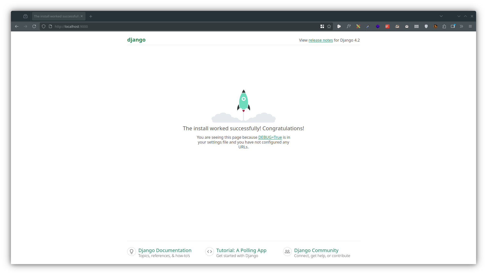
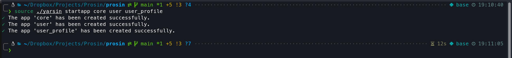
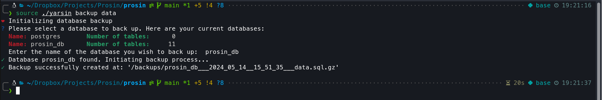

<div dir="rtl" align="right" markdown="1" style="font-family: 'Vazirmatn RD', IRANSansX, Arial, sans-serif;">

# 🪵 جَنْسین

«**جَنْسین**» [یه](https://www.fayzen.ir/wiki/یه) سیستم [چَنْخادْمایی](https://www.fayzen.ir/wiki/چنخدمایی) (چند سرویسی) برپایه Docker است که برای [واسْعانْدَن](https://www.fayzen.ir/wiki/واسعاندن) (توسعه دادن) و [ئاجْرانْدَن](https://www.fayzen.ir/wiki/ئاجراندن) (اجرا کردن) نرم‌افزارها برپایه Django [طَرْحانِشْدِه](https://www.fayzen.ir/wiki/طرحانشدن) (طراحی شده است).

---

## 🚀 [کُلْبین](https://www.fayzen.ir/wiki/کلبین) (دید کلی)

این پروژه از چهار [خدْمال](https://www.fayzen.ir/wiki/خدمال) (سرویس) اصلی [شَکْلانِشْدِه](https://www.fayzen.ir/wiki/شکلانشدن) (تشکیل شده است):

1. web (Nginx): برای [هادْیانْدَن](https://www.fayzen.ir/wiki/هادیاندن) (هدایت کردن) [عُبورِش](https://www.fayzen.ir/wiki/عبورش) (ترافیک) HTTP به [خَدْمالْ‌ها](https://www.fayzen.ir/wiki/خدمال) (سرویس‌ها)؛
2. api (Django): چارچوب جنگو که هسته اصلی سیستم است؛
3. db (PostgreSQL): پایگاه‌داده اصلی پروژه؛
4. pgadmin (pgAdmin4): ابزاری تحت وب برای [أَدْرانْدَن](https://www.fayzen.ir/wiki/ادراندن) (مدیریت کردن) پایگاه‌داده اصلی.



و [یه](https://www.fayzen.ir/wiki/یه) دستیار به نام `yarsin` برای [تایْسانْدَن](https://www.fayzen.ir/wiki/تایساندن) (سازماندهی کردن) دستورها و فایل‌های `bash`؛ بطوریکه برای [سازْیانْدَن](https://www.fayzen.ir/wiki/سازیاندن) (ساختن) [بِرْکاهای](https://www.fayzen.ir/wiki/برکا) (app) `core`، `user`، و `user_profile` [کایَد](https://www.fayzen.ir/wiki/کاید) (کافیه) [فَرْماء](https://www.fayzen.ir/wiki/فرماء) (دستور) زیر را [بِئاجْرانیم](https://www.fayzen.ir/wiki/اجریدن) (اجرا کنیم):

<div dir="ltr" align="left" markdown="1">

```bash
source ./yarsin startapp core user user_profile
```

</div>



و برای [مانِزْیانْدَن](https://www.fayzen.ir/wiki/مانزیاندن) (بکاپ گرفتن از) پایگاه‌داده‌ها:

<div dir="ltr" align="left" markdown="1">

```bash
source ./yarsin backup data
```

</div>



و برای [أَضْفانْدَن](https://www.fayzen.ir/wiki/اضافدن) [یه](https://www.fayzen.ir/wiki/یه) فایل script، [کایَد](https://www.fayzen.ir/wiki/کاید) آن را در <span dir="ltr" markdown="1">`./scripts/sources`</span> [بِمَحلانیم](https://www.fayzen.ir/wiki/محلاندن) (قرار بدهیم):

<div dir="ltr" align="left" markdown="1">

```bash
# ./scripts/sources/test
#!/usr/bin/env bash

echo "This is a test bash script..."
```

</div>

سپس با <span dir="ltr" markdown="1">`source ./yarsin <script name>`</span> [بِأَجْرانیم](https://www.fayzen.ir/wiki/اجراندن) [اَش](https://www.fayzen.ir/wiki/اش) (اجرایش کنی):

<div dir="ltr" align="left" markdown="1">

```bash
source ./yarsin test
```

</div>

---

## 🏄‍♂️ [بَهْرانِش](https://www.fayzen.ir/wiki/بهرانش) (روش استفاده)

برای [بَهْرانْدَن](https://www.fayzen.ir/wiki/بهراندن) (استفاده کردن از) این سیستم [باید](https://www.fayzen.ir/wiki/باید) [داکر](https://docs.docker.com/desktop/) و [داکرکامپوز](https://docs.docker.com/compose/install/) در سیستم [اَت](https://www.fayzen.ir/wiki/ات) (تو) [بِنَصْبانِشَنْد](https://www.fayzen.ir/wiki/نصبشتن) (نصب بشوند). و [هایَد](https://www.fayzen.ir/wiki/هاید) (بهتره) [Makefile](https://makefiletutorial.com/) هم [بِدارائی](https://www.fayzen.ir/wiki/دارائدن) (داشته باشی) وگرنه باید دستورهای در `Makefile` را بشکل دستی [بِاِجْری](https://www.fayzen.ir/wiki/اجریدن) (اجرا کنی).

### ⛳️ [عَلْنانْدَن](https://www.fayzen.ir/wiki/علناندن) [نَیِزْماءْها](https://www.fayzen.ir/wiki/نیازماء)

برای [عَلْنانْدَن](https://www.fayzen.ir/wiki/علناندن) [نَیِزْماءْهای](https://www.fayzen.ir/wiki/نیازماء) (تعیین نیازهای) هر [أَجِرْلان](https://www.fayzen.ir/wiki/اجرلان) (محیط اجرا؛ Environment) [تایَد](https://www.fayzen.ir/wiki/تاید) (می‌توانی) فایل [مّنِسْناک](https://www.fayzen.ir/wiki/منسناک) (مناسب) را [بِبَهْرانی](https://www.fayzen.ir/wiki/بهراندن) (استفاده کنی):

<div dir="ltr" align="left" markdown="1">

#### 📍 <span dir="ltr" markdown="1">`/requirements/base.txt`</span>

```requirement
## Building Powerful Web Applications with Django and Environment Variable Management
Django==5.2.8                           # Core Python web framework used to build scalable, secure, and maintainable applications.
django-environ==0.12.0                  # Environment variable management for secure and flexible configuration handling.

daphne==4.2.1                           # ASGI server that enables Django Channels to support asynchronous requests and WebSockets.
channels==4.3.1                         # Framework for handling WebSockets and asynchronous features in Django.
```

#### 📍 <span dir="ltr" markdown="1">`/requirements/development.txt`</span>

```requirement
-r base.txt

## Database Connectivity
psycopg2-binary==2.9.11                 # PostgreSQL adapter for Python that provides efficient database communication.

## Code Quality and Formatting Tools
isort==5.13.2                           # Tool that automatically organizes and orders Python imports.
flake8==7.0.0                           # Linting tool for enforcing Python code style and detecting common issues.
Flake8-pyproject==1.2.3                 # Flake8 extension that allows configuration through pyproject.toml.
black==24.3.0                           # Opinionated code formatter for maintaining consistent code style across the project.

colorlog==6.10.1                        # Enhances logging output with colors to improve readability during development.

pytest-django==4.11.1                   # Pytest plugin that provides Django integration for simplified and powerful testing workflows.
```

</div>

### ⛳️ [آغْزانْدَن](https://www.fayzen.ir/wiki/آغزاندن) پروژه

[پَسَز](https://www.fayzen.ir/wiki/پسز) [عَلْنانْدَن](https://www.fayzen.ir/wiki/علناندن) (اعلان کردن) [نَیِزْماء‌های](https://www.fayzen.ir/wiki/نیازماء) پروژه [اَت](https://www.fayzen.ir/wiki/ات)، دستور زیر را [بِئاجْران](https://www.fayzen.ir/wiki/ئاجراندن) (اجرا کن) تا [یه](https://www.fayzen.ir/wiki/یه) پروژه جدید جنگو برایت [أَیْجانِشَد](https://www.fayzen.ir/wiki/ایجشدن) (ایجاد شود):

<div dir="ltr" align="left" markdown="1">

```bash
# This is the same as running "django-admin startproject config ."
make new-project # OR: source ./yarsin new-project
```

</div>

### ⛳️ [پِیاکْرانْدَن](https://www.fayzen.ir/wiki/پیاکراندن) جنگو

چون فایل [پِیاکْران](https://www.fayzen.ir/wiki/پیاکران) (پیکربندی) <span dir="ltr" markdown="1">`./config/settings.py`</span> به <span dir="ltr" markdown="1">`./config/settings/base.py`</span> [ناقْلانِشدِه](https://www.fayzen.ir/wiki/نقلشدن) (منتقل شده)، باید [پِیاکْراء](https://www.fayzen.ir/wiki/پیاکراء) (عالم پیکربندی) `BASE_DIR` را [بِصَلْحانی](https://www.fayzen.ir/wiki/صلحاندن) (اصلاح کن):

<div dir="ltr" align="left" markdown="1">

#### 📍 <span dir="ltr" markdown="1">`/config/settings/base.py`</span>

```python
# ...
# Build paths inside the project like this: BASE_DIR / 'subdir'.
BASE_DIR = Path(__file__).resolve().parent.parent.parent
# ...
```

</div>

و از [غَیِرْپَذیرهای](https://www.fayzen.ir/wiki/غیرپذیر) [مَحِلْناک](https://www.fayzen.ir/wiki/محلناک) (متغیرهای محلی) برای [عَیْنانْدَن](https://www.fayzen.ir/wiki/عیناندن) (معین کردن) `DEBUG` و `DEBUG` [بِبَهْران](https://www.fayzen.ir/wiki/بهراندن) (استفاده کن):

<div dir="ltr" align="left" markdown="1">

#### 📍 <span dir="ltr" markdown="1">`/config/settings/base.py`</span>

```python
# ...
from environ import Env

env = Env()
# ...
# SECURITY WARNING: keep the secret key used in production secret!
SECRET_KEY = env.str("SECRET_KEY")

# SECURITY WARNING: don't run with debug turned on in production!
DEBUG = env.bool("DJANGO_DEBUG", False)
# ...
```

</div>

و <span dir="ltr" markdown="1">`ALLOWED_HOSTS = []`</span> را برای [حَفْظانْدَن](https://www.fayzen.ir/wiki/حفظاندن) [اَمَنیَّت](https://www.fayzen.ir/wiki/امنیت) از <span dir="ltr" markdown="1">`./config/settings/base.py`</span> به <span dir="ltr" markdown="1">`./config/settings/development.py`</span> [بِبَدْلان](https://www.fayzen.ir/wiki/نقلدن):

<div dir="ltr" align="left" markdown="1">

#### 📍 <span dir="ltr" markdown="1">`/config/settings/development.py`</span>

```python
# ...
# List of host/domain names that this Django site can serve. Must be set in production to prevent host header attacks.
ALLOWED_HOSTS = ['*']

CSRF_TRUSTED_ORIGINS = [
    'http://localhost:9000',
    'http://127.0.0.1:9000',
]
```

</div>

### ⛳️ [پِیاکْراندن](https://www.fayzen.ir/wiki/پیاکراندن) پایگاه‌داده

برای [پِیاکْراندن](https://www.fayzen.ir/wiki/پیکردن) (پیکربندی) جنگو بِقَصْد [بَهِرْدَن](https://www.fayzen.ir/wiki/بهردن) (استفاده کردن از) پایگاه‌داده `PostgreSQL`، [پِیْکَراف](https://www.fayzen.ir/wiki/پیکراف) `DATABASES` را [بِصَلِح](https://www.fayzen.ir/wiki/صلحدن):

<div dir="ltr" align="left" markdown="1">

#### 📍 <span dir="ltr" markdown="1">`/config/settings/base.py`</span>

```python
# ...
DATABASES = {"default": env.db("DATABASE_URL")}
# ...
```

</div>

### ⛳️ [پِیاکْراندن](https://www.fayzen.ir/wiki/پیاکراندن) فایل‌های ایستا

 برای [عَلْنانْدَن](https://www.fayzen.ir/wiki/علندن) محل [جَمْلِشْدِگی](https://www.fayzen.ir/wiki/جملدن) (گرآوری) فایل‌های ایستا، باید با [غَیِرْمَل](https://www.fayzen.ir/wiki/غیمل) (متغیر محلی) `STATIC_ROOT` پوشه [جَمْلایِش](https://www.fayzen.ir/wiki/جملایش) (گردآوری) فایل‌های ایستا را [بِعالْمانی](https://www.fayzen.ir/wiki/علمدن) (اعلام کنی):

<div dir="ltr" align="left" markdown="1">

#### 📍 <span dir="ltr" markdown="1">`/config/settings/base.py`</span>

```python
# ...
# Static files (CSS, JavaScript, Images)
# https://docs.djangoproject.com/en/5.2/howto/static-files/

# Static files settings
STATIC_URL = "static/"
# Directory where Django will collect static files (CSS, JS, images).
STATIC_ROOT = env.path("STATIC_ROOT")
# The directories where Django looks for static file sources.
STATICFILES_DIRS = [
    BASE_DIR / "static",
]
# ...
```

</div>

🪜 [پِیْکَراءْهای (پیکربندی‌های) اَهِمْناک (مهم) دیگر...](docs/after_installing.md)

### ⛳️ [ئاجْرانْدَن](https://www.fayzen.ir/wiki/ئاجراندن) پروژه

درپایان، برای [أَجْرانْدَن](https://www.fayzen.ir/wiki/ئاجراندن) (به اجرا درآوردن) پروژه‌ات دستور زیر را [بِئاجْران](https://www.fayzen.ir/wiki/ئاجراندن) (اجرا کن):

<div dir="ltr" align="left" markdown="1">

```bash
make up # OR: docker compose up -d

# To fix the permission issue, run the following command:
source ./yarsin init-volumes

# To view the Django server logs, run the following command:
docker logs djansin_api
```

</div>

پایان! 🎉 حالا ازطریق [وَنْداءْهای](https://www.fayzen.ir/wiki/ونداء) (لینک‌های) زیر [توانائی](https://www.fayzen.ir/wiki/توانائدن) (می‌توانی) به هر یک از [خَدْمال‌ها](https://www.fayzen.ir/wiki/خدمال) [اَت](https://www.fayzen.ir/wiki/ات) (سرویس‌هایت) [بَدَسْسانی](https://www.fayzen.ir/wiki/دسساندن) (دسترسی بیابی):

- پروژه (صفحه جنگو): <span dir="ltr">[localhost:9000/](http://localhost:9000/)</span>
- [أَدْرال](https://www.fayzen.ir/wiki/ادارال) پایگاه‌داده (pgAdmin): <span dir="ltr">[pg.localhost:9000/](http://pg.localhost:9000/)</span> (user: `admin@email.com`, pass: `123456`)

---

## 🪄 یارْسین

برای [اِجْریدَن](https://www.fayzen.ir/wiki/اجریدن) (اجرا کردن) دستورهای `django-admin` [تَوانائی](https://www.fayzen.ir/wiki/تونائدن) (می‌توانی) دستیار <span dir="ltr">`./yarsin`</span> را مانند زیر [بِبَهِری](https://www.fayzen.ir/wiki/بهردن) (به‌کار بگیری):

<div dir="ltr" align="left" markdown="1">

```bash
source ./yarsin [django-admin comments|cuatom camments] [options]
```

</div>

مثلا، برای [آغازْدَن](https://www.fayzen.ir/wiki/آغازدن) (آغاز کردن) چند [ریزبرکا](https://www.fayzen.ir/wiki/ریزبرکا) (برنامه کاربردی) [کایَد](https://www.fayzen.ir/wiki/کاید) (کافیه) مانند زیر [بِعَمَلی](https://www.fayzen.ir/wiki/عملیدن) (عمل کنی):

<div dir="ltr" align="left" markdown="1">

```bash
source ./yarsin startapp core user
```

</div>

⚠️ این درمورد همه دستورهای [عَبِرْناک](https://www.fayzen.ir/wiki/عبرناک) (معتبر) `django-admin` [قَرِرْمائَد](https://www.fayzen.ir/wiki/قررمائدن) (برقرار است)!

### 🩺 دستورهای [نِگَهِش](https://www.fayzen.ir/wiki/نگهش) (نگهداری)

- [مانوزْدَن](https://www.fayzen.ir/wiki/مانوزدن) [سَمْپاد](https://www.fayzen.ir/wiki/سمپاد) (بکاپگیری در سطح فایل):

  <div dir="ltr" align="left" markdown="1">

  ```bash
  source ./yarsin backup dbms
  ```

  </div>

- [مانوزْدَن](https://www.fayzen.ir/wiki/مانوزدن) پایگاه‌داده (بکاپگیری در سطح پایگاه‌داده):

  <div dir="ltr" align="left" markdown="1">

  ```bash
  source ./yarsin backup data
  ```

  </div>

- [پیشارْدَن](https://www.fayzen.ir/wiki/پیشاردن) (برگرداندن) [سمپاد](https://www.fayzen.ir/wiki/سمپاد):

  <div dir="ltr" align="left" markdown="1">

  ```bash
  source ./yarsin restore dbms
  ```

  </div>

- [پیشارْدَن](https://www.fayzen.ir/wiki/پیشاردن) (برگرداندن) پایگاه‌داده:

  <div dir="ltr" align="left" markdown="1">

  ```bash
  source ./yarsin restore data
  ```

  </div>

---

## 💡 چگونه

- [چگونه ریزبِرْکاها را در یک پوشه بِتایِسیم (سازماندهی کنیم)؟](docs/using_an_apps_folder.md)
- [چگونه فایل‌های ایستا و رسانه را بِتایِسیم (سازماندهی کنیم)؟](docs/handling_django_static_and_media_files.md)
- [چگونه پروژه اِمان را بِمِلّیکیم (ملی‌ساز) و بِمِلَلِکیم (بین‌المللی‌سازی کنیم)؟](docs/internationalization_and_iocalization.md)
- [چگونه اِطَلِعان‌های آسیباوَر (اطلاعات حساس) را با غَیِرْپَذیر مَحِلْناک (متغیرهای محلی) بِکیاسیم (هندل کنیم)؟](docs/using_env_file_in_django.md)

</div>
